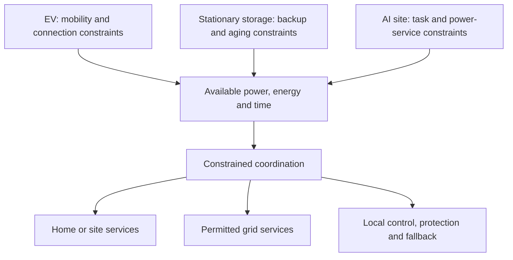

# Learning in public: EV platforms, V2H/V2G, and AI power systems

I’m exploring how vehicles and other battery systems can exchange energy while still meeting their original tasks. I’m early in learning this area, and I’d appreciate corrections from people working on EVs, charging, power electronics, storage, and energy systems.

This is a concept note and a request for feedback. I have not built a prototype or run the proposed experiments. I’m especially interested in learning which parts are already standard practice and where a small, reproducible study could still be useful.

**Feedback / 交流：** [Share a correction, paper, dataset, or starting-problem suggestion](https://github.com/XJZ07150520/XJZ07150520/issues/1). English and 中文 are both welcome.

## 1. Utility EV platforms: what should be reusable?

I’m interested in vehicle families that reuse electrical interfaces, drive systems, controls, and energy capabilities across different uses. Buick’s **Xiaoyao / 逍遥** architecture is one motivating example: GM’s announcement describes support for MPV, SUV, and sedan development, several electrified powertrains, and different drive layouts. That does **not** establish that every vehicle uses the same motor or that bodies are interchangeable.[1]

My interest extends beyond mechanical design to **bidirectional power conversion, V2H/V2G, battery constraints, serviceability, and sustainability**.

- Which interfaces are useful to standardize across vehicle types, and which depend too strongly on load, thermal limits, safety, or packaging?
- For a beginner interested in V2H/V2G, is the best starting problem in the vehicle, charger, BMS interface, or site energy controller?
- What can be learned from Chinese platform integration and product development, and what needs to change for a US installation and utility environment?

## 2. AI + power electronics: where does prediction help?

I’m also interested in dynamic AI loads, DC-bus regulation, storage coordination, and reserve constraints. The question is where prediction or learning improves a system that already has good local control and protection.

- What public models or measurements would make a useful first experiment?
- Which simple rule, forecast, or MPC baseline should an AI-based approach have to beat?
- What must remain safe when the forecast is wrong or communication is lost?

## 3. A possible connection: task-aware energy reserves

An EV needs energy for the next trip. Stationary storage may have a backup commitment. A critical power system has continuity requirements. Could these be expressed through comparable **available-power / energy / time envelopes**, while keeping their different hardware and reliability requirements?

This is a modeling question, not a claim that a privately owned EV can replace a data center UPS.

A possible first study would use **one EV, a home load, and stationary storage**, compare fixed reserve thresholds with state-dependent constraints, and test early departure, prediction error, and disconnection. I would first check how existing EMS, DERMS, VPP, and vehicle-grid research already handle these cases.

**Would that be a useful starting problem? If not, what smaller question would you suggest?** Feedback pointing out a wrong assumption, an existing solution, a public dataset, or a useful paper would be particularly helpful.

### A few facts informing the questions

| Observation | Scope |
|---|---|
| Tesla remains the largest US new-BEV brand in the latest quarter reviewed | Cox/KBB Q3 2026 estimates: 144,094 Tesla vehicles / 262,649 BEVs. The ratio is **54.86%**, calculated from unit counts. The PDF prints 54.0% in its share column, which does not reconcile with those counts.[2] |
| GM Energy already offers V2H products | Requires compatible vehicles and correctly installed equipment. Hardware capability, home backup, and enrollment in grid services are different milestones.[3] |
| Tesla’s current Powershare scope has expanded | Its official page includes Cybertruck and eligible new Model 3/Y orders in the US and Puerto Rico from October 1, 2026; older vehicles and equipment compatibility require checking.[4] |

Chinese-market technical competitiveness and permission to sell connected vehicles in the US are separate questions. BIS currently lists phased restrictions and authorization mechanisms; I am not assuming automatic or near-term market entry.[5]

中文：我想请教的三个方向

### 一、多用途 EV 平台与车—家—网能源系统

我想了解的是：不同用途的电动车，能否在电气架构、驱动、充电、储能和软件接口上形成更多共用能力？其中哪些是真正值得标准化的，哪些会因为载荷、热管理、维修与安全要求而必须不同？

别克“逍遥”架构跨 MPV、SUV、轿车开发的思路让我觉得很有启发。但我也意识到，“共用平台”不等于“同一个电机”，更不等于“车身随便更换”。我对具体力学和机械设计还在学习，目前更想从电气系统与功能接口理解这些问题。

我尤其想请教：

1. 想学习 V2H / V2G，最值得先弄懂的是车载或桩侧功率变换、BMS 约束、通信，还是家庭/站点能源管理？
2. 比较 Tesla、GM 以及中国平台的不同路线时，哪些指标比“几合一”、峰值充电功率或品牌销量更有意义？
3. 如何把可持续性落实为循环寿命、效率、可检测、可维修、材料与回收等可以比较的需求？高度集成的系统会带来什么维修与升级代价？
4. 美国的住宅安装和 utility 场景，与中国市场有哪些关键差异？有什么公开案例适合初学者学习？

### 二、AI、功率电子与储能控制

我想继续研究动态负载、直流母线、双向变换器与储能协同。我的疑问是：在已经有可靠本地控制与保护的前提下，AI 预测到底能改善什么？如何证明它优于简单预测、规则和优化基线？

我希望先找到一个有公开模型、参数和数据的小问题，而不是直接给自己定一个完整系统的目标。

### 三、两者的结合：先满足任务，再讨论可调度能量

车辆先满足出行，储能先兑现备用，AI 站点先保障任务与供电。它们能否用相似的方法描述“当前到底能调多少功率、持续多久、什么时间可用，以及失效时怎么办”？

例如，一个纯教学假设：60 kWh 电池，当前 SOC 80%，出行预留 40%，放电效率 90%，扣除出行预留后的交流电量是 21.6 kWh。但如果它只连接 4 小时、输出上限为 3 kW，本次可输出电量的简化上界就是 12 kWh。这个算术例子并不包含温度、故障、提前离开等完整约束，也不对应某款车型。

我知道这些基本思想可能已经被成熟系统采用。更希望得到的反馈是：**哪些理解不准确？哪些问题早已解决？哪一个小问题还值得自己动手复现和研究？**

### Sources

Reviewed October 22, 2026. Manufacturer statements describe announced capabilities and conditions; they are not independent performance tests.

1. [GM China — Buick Xiaoyao architecture announcement, April 21, 2025](https://news.gm.com.cn/zh/home.detail.html/Pages/news/cn/zh/2025/apr/0421-buick.html)
2. [Cox/KBB — Q3 2026 EV Sales Report, updated October 13](https://www.coxautoinc.com/wp-content/uploads/2026/10/Q3-2026-Kelley-Blue-Book-EV-Sales-Report-updated-as-of-10-13-26.pdf)
3. [GM Energy — V2H solutions](https://gmenergy.gm.com/for-home/products/vehicle-to-home-solutions) and [GM — bidirectional EVs and utility collaboration, June 9, 2026](https://news.gm.com/home.detail.html/Pages/news/us/en/2026/jun/0609-bidirectional-evs.html)
4. [Tesla — Powershare, current eligibility and equipment conditions](https://www.tesla.com/powershare)
5. [US BIS — Connected Vehicles overview](https://www.bis.gov/connected-vehicles)
6. [BYD — e-Platform 3.0 announcement, historical platform-integration example](https://en.byd.com/news/byd-debuts-e-platform-3-0-leading-the-next-generation-of-smart-electric-vehicles/)

*Prepared with AI assistance. Proposed experiments have not been run.*
