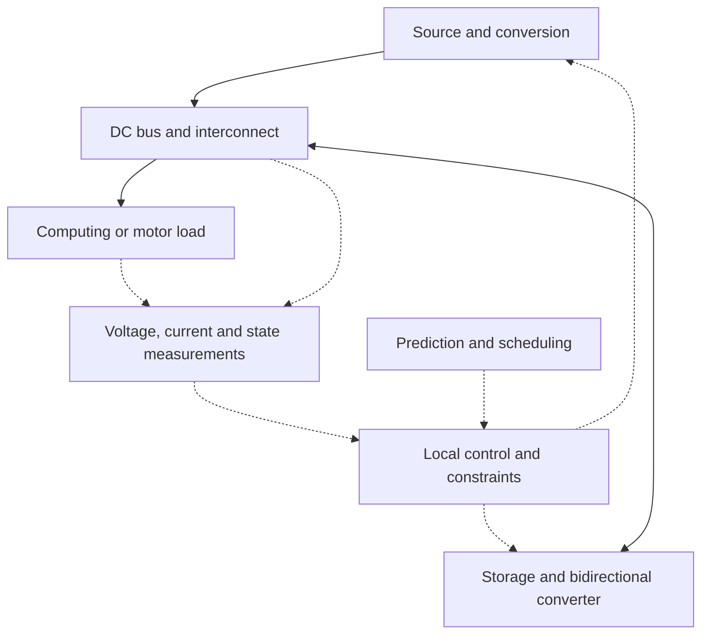

# Electrical engineering research: papers, questions, and reproducible first studies

**电气研究主线：电力电子 · 控制 · 嵌入式 · 电机 · 能源系统**

Reviewed October 23, 2026. This is a reading map and proposed research agenda. No new converter, experiment, simulation result, or publication is claimed here.

I’m interested in how electrical systems convert, deliver, buffer, and control energy. EVs, homes, AI computing systems, and electrically actuated robots are application contexts. I’d appreciate feedback on which electrical problem is a useful first study and which assumptions or proposed comparisons need correcting.

**Start here:** DC-bus dynamics and constrained energy buffering → a reproducible controller benchmark → bidirectional conversion or motor-drive extensions. [Feedback and discussion](https://github.com/XJZ07150520/XJZ07150520/issues/1) · [Profile](../README.md)

The proposed first comparison is a well-tuned PI controller, measured-load feedforward, constrained MPC, and the same MPC with a learned forecast, under identical plant and storage limits. I would test power saturation, exhausted reserves, model error, and delayed or missing information. Public 0.1–0.2 s AI power traces can support slower energy-management studies; they do not establish millisecond bus-transient performance. The eight-paper map below separates reviewed publications, preprints, public data, and access limitations. **Which published example would be the best first reproduction, and what important electrical constraint does this proposed benchmark miss?**

## 1. 我究竟想研究什么？

核心是弄清楚：**电压为什么会跌落或振荡；电流、器件、储能和控制器能否及时响应；预测与优化在什么条件下真正有帮助。** 这些问题可以从电路和控制层面建模、测量、复现。

这里把两种 AI 关系分开：

| 关系 | 电气研究对象 | 应该用什么证据判断 |
|---|---|---|
| Power for AI：为 AI 系统供电 | 电源转换、母线、功率分配、储能、VRM/PDN、供电连续性 | 电压/电流波形、损耗、温升、阻抗、故障和恢复过程 |
| AI for power：用学习方法改善电气系统 | 负载预测、参数估计、控制整定、状态估计、调度 | 同一物理系统与约束下，和强 PI、规则、前馈、MPC 基线比较 |
| 具身智能的电气接口 | 电机驱动、电流/转矩控制、共直流母线、再生能量、热约束 | 跟踪误差、母线过压、峰值电流、回收能量与任务完成情况 |

电气研究的共同骨架如下；不同场景仍需要各自的模型、硬件和可靠性要求。

实线表示功率路径，虚线表示测量、预测或控制信息。

## 2. 六条电气研究线，以及每条线的小问题

以下是范围和优先级建议，不是对研究热度或成功概率的量化排名。

| 方向 | 可以研究的小问题 | 最小起步工作 | 应报告的量 | 建议位置 |
|---|---|---|---|---|
| **直流母线与动态供电** | 限流、有限储能和延迟下，负载突变何时导致欠压/振荡？ | 源—母线电容—负载—缓冲器平均模型；PI 与前馈 | 电压偏差、恢复时间、电流、约束越限 | **首选起点** |
| **双向 DC/DC 与 DAB** | 电池电压变化时，怎样兼顾瞬态、RMS 电流、软开关与损耗？ | 复现 SPS 的功率与电流；再比较一种 DPS/TPS 方法 | RMS/峰值电流、ZVS 范围、损耗、瞬态直流偏置 | 电力电子深化 |
| **储能状态与任务预留** | 备用能量、电池状态和功率上限如何约束可调度能力？ | SOC 模型、能量守恒、固定与状态相关预留比较 | 任务满足、能量缺口、SOC、吞吐量；寿命结论另需验证 | 与 EV/家庭能源连接 |
| **VRM 与电源完整性** | 封装/板级 R、L、C 与控制带宽如何影响电压跌落和阻抗峰？ | 简化 PDN 等效网络、阻抗扫描、负载阶跃 | IR drop、L·di/dt、目标阻抗、去耦敏感性 | 后续分支；与机架模型分层 |
| **电机驱动与再生制动** | 多轴减速再生时，谁吸收能量？输入功率受限时如何维持任务？ | 电机/逆变器和负载模型；电流/转矩控制；单轴后多轴 | 跟踪误差、母线过压、回收能量、热/电流约束 | 连接具身智能 |
| **并网变流器与 GFM 储能** | 大负载扰动、弱网和通信延迟下，储能控制如何影响稳定性？ | 先复现一个公开 EMT 案例和控制器 | PCC 功率、频率/电压、振荡、故障恢复 | 更大系统的后续工作 |

DAB = dual-active-bridge；SPS/DPS/TPS = 单/双/三移相；GFM = grid-forming；PDN = power delivery network；VRM = voltage regulator module。

## 3. 首选课题：有限功率与能量下的直流母线缓冲控制

**拟题：面向脉冲负载的直流母线供电：功率与能量约束下的缓冲控制及公平基准比较。**

*Working title: Constrained DC-bus buffering for bursty loads: dynamics, reserve limits, and reproducible controller comparisons.*

这是一个研究问题和复现入口，尚未建立新颖性。DC 微电网稳定、混合储能、负载前馈、MPC、储能备用与数据中心功率支撑已有大量研究。[R1–R6] “把 AI 和电池放在一起”本身不足以形成论文贡献。

### 3.1 先回答四个可检验的问题

1. 相同的平均功耗，负载脉冲的幅值、持续时间和重复间隔分别怎样改变母线电压和缓冲器需求？
2. 源或缓冲器触及电流/功率上限后，PI、前馈和 MPC 的表现如何变化？哪些工况从物理上就无法满足？
3. 预测带来的改善能否在误差、延迟、参数变化和未见过的负载下保留？
4. 失去预测或通信时，已有本地控制与回退逻辑能否保持明确、可测试的行为？

### 3.2 最小物理模型

先从母线电容的能量平衡开始：

$$
\frac{C}{2}\frac{dV_{dc}^{2}}{dt}
=P_{source}+P_{buffer}-P_{load}-P_{loss}.
$$

这里的功率都以同一母线边界计量，$P_{buffer}>0$ 表示缓冲器向母线放电。缓冲器内部储能再用充放电效率更新，避免把电池侧和母线侧功率混为一谈。

电路电感、电容 ESR/ESL、变换器带宽、采样与计算延迟会在后续模型中逐项加入。平均模型可以研究一部分动态，不能凭它宣称开关尖峰、EMI、器件应力或芯片供电完整性已经验证。

一个重要切入点是负载性质：若在某个频段可近似恒功率，$I=P/V$，则

$$
\frac{dI}{dV}=-\frac{P}{V^2},\qquad
r_{incremental}=-\frac{V^2}{P}.
$$

这解释了为什么某些受控负载会削弱系统稳定裕量；实际是否振荡还取决于源/负载阻抗、滤波与控制。[R1] 不能把所有 GPU、所有运行阶段都直接当成理想恒功率负载。

### 3.3 一组物理计算，说明“功率”和“能量”不是一个要求

**以下为自算的理想教学情景，不是实测或仿真结果，也不是器件选型。** 假设出现额外 **100 kW** 负载，源完全来不及响应，持续 **20 ms**，全部缺口由电容供给：

$$E=\Delta P\Delta t=2{,}000\;J=0.556\;Wh.$$

允许电压从 $V_0$ 降到 $0.95V_0$ 时：

$$C=\frac{2E}{V_0^2-(0.95V_0)^2}.$$

| 同一教学情景 | 48 V 母线 | 800 V 母线 |
|---|---:|---:|
| 初始电压 | 48 V | 800 V |
| 最低允许电压（下降 5%） | 45.6 V | 760 V |
| 在初始电压下承载额外 100 kW 的理想电流 | 2,083 A | 125 A |
| 20 ms 内需填补的能量 | 2,000 J / 0.556 Wh | 2,000 J / 0.556 Wh |
| 理想最小电容 | 17.806 F | 64.103 mF |

**启发：能量只有约 0.56 Wh，瞬时功率却有 100 kW。** 只给出电池 kWh，无法证明它能够支撑这种扰动。缓冲器功率、变换器带宽、导体、阻抗、保护与热设计仍然关键。800 V 是供电架构层级的比较，不表示 GPU 核心直接使用 800 V；不同架构的总效率也不能从这个算式推出。[R4]

对比还必须看持续时间：相同 100 kW 缺口，1 ms 为 0.0278 Wh，20 ms 为 0.5556 Wh，1 s 为 27.78 Wh，60 s 为 1.667 kWh。短时动态缓冲与长时备用需要分别建模。

### 3.4 控制比较要公平

| 组别 | 控制方法 | 要控制住的比较条件 |
|---|---|---|
| B0 | 整定合理的 PI，包含抗积分饱和与实际限流 | 不能拿故意很弱的 PI 当基线 |
| B1 | 同一 PI + 已测负载前馈 | 检查简单物理信息已能带来多少改善 |
| B2 | 带功率、能量、爬坡与预留约束的 MPC，使用简单持续性预测 | 检查显式约束和优化的价值 |
| B3 | 与 B2 相同的 MPC + 学习得到的预测 | 仅改变预测部分，避免把多项变化全部归因于 AI |
| Oracle | 完美未来信息下的参考解 | 只作参考上界，不能当可部署控制器 |

使用同一被控对象、容量、电流限制、扰动、测量信息、评估时间窗和延迟假设。报告计算时间和控制周期；离线算得出的优化解并不自动满足实时性。负载/任务划分训练集和测试集，避免把同一段轨迹的相邻切片泄漏到两边。

优先完成 B0/B1 与模型校验，再增加 B2；只有预测在目标时间尺度上具有可用信息时，才增加 B3。在线学习控制是已有研究方向，[R3] 但这里不预设它优于传统控制。

### 3.5 实验矩阵与应交付的图

以下全部是**计划中的比较**，目前没有结果。

| 场景 | 改变什么 | 图和记录 |
|---|---|---|
| 阶跃和重复脉冲 | 幅值、持续时间、重复间隔 | 负载/源/缓冲功率、母线电压 |
| 触及上限 | 缓冲功率、初始可用能量、源爬坡限制 | 限幅、未供给能量、最低电压；标明不可行区 |
| 参数偏差 | 电感/电容、ESR、源阻抗、负载特性 | 扰动响应与稳定裕量的变化 |
| 测量/通信问题 | 延迟、噪声、丢失预测、错误时间戳 | 恢复过程、回退切换、饱和持续时间 |
| 慢时间尺度真实负载 | 公开 AI 工作负载轨迹 | 源功率波动、储能预留与能量循环 |
| EV 或电机扩展 | EV 提前离开，或电机减速再生 | 任务满足、母线过压、回收/弃用能量 |

主要指标：最大电压偏差、恢复时间、峰值/RMS 电流、源功率爬坡、最小预留能量、约束越限次数/持续时间/幅度、不可行情况、计算时间。恢复时间的电压带宽与保持时长要先定义。电池吞吐量或 RMS 电流只能作相应代理指标；寿命和损耗改善要有对应模型或测量。

在有限测试中观察到零越限，是测试结论；它不是连续时间、所有工况下的安全性证明。约束方法的保证范围应随模型、可行性、误差边界和采样假设一起报告。

## 4. 时间尺度：论文和数据必须配对

| 研究层 | 可用的起步证据 | 不能直接推出的结论 |
|---|---|---|
| 秒级及更慢的能量协调 | 公开 AI 负载轨迹、储能状态、任务/出行约束 | 某个母线能否承受毫秒级突变 |
| 毫秒级母线与变换器控制 | 具有明确带宽的电路模型、合成扰动、足够快的台架测量 | 芯片引脚/封装的高速电压完整性 |
| 开关周期和更快的电源完整性 | 开关模型、寄生参数、布局/封装模型与相应带宽的测量 | 仅凭慢速遥测就验证瞬态或 EMI |

[R5] 论文介绍了 0.1 s 采样的 H100 工作负载测量；对应数据目录明确说明包含 **5/10 Hz，即 0.2/0.1 s** 的轨迹。[D1] 每 100 ms 一个点，并不能揭示 20 ms 内波形，更不能用插值“补出”真实高频信息。

因此应开两条验证路径：真实轨迹支持较慢的系统与储能研究；快速控制使用明确标记的合成扰动、电路仿真或足够高采样率的实验。二者可关联，但证据范围要分别说明。

## 5. 八篇论文的阅读地图

这是精选入口，不是系统性文献综述。核对深度已标明；未声称复现论文或核查了每一项实验结果。预印本与期刊论文分别列出。

| 编号 | 论文与核实入口 | 年份 / 类型 | 为什么读、准备复现什么 | 本次核对深度 |
|---|---|---|---|---|
| **R1** | Dragicevic, Lu, Vasquez Quintero & Guerrero, **[DC Microgrids – Part I: A Review of Control Strategies and Stabilization Techniques](https://vbn.aau.dk/en/publications/dc-microgrids-part-i-a-review-of-control-strategies-and-stabiliza/)**. DOI: 10.1109/TPEL.2015.2478859 | 2016，IEEE TPEL 31(7), 4876–4891；同行评审综述 | 理解本地/协调控制、负增量阻抗与源负载交互；先复现简单系统的稳定/振荡边界 | 作者机构的摘要、书目及稿件入口 |
| **R2** | **[Review of Modeling, Modulation, and Control Strategies for the Dual-Active-Bridge DC/DC Converter](https://www.mdpi.com/1996-1073/16/18/6646)**. DOI: 10.3390/en16186646 | 2023，Energies 16(18), 6646；综述 | 建立 DAB 的模型/调制/控制分类；从 SPS 开始，再只选一种扩展方法 | 出版社索引/摘要；本次全文读取受限 |
| **R3** | Wan, Xu & Dragicevic, **[Safety-Enhanced Self-Learning for Optimal Power Converter Control](https://orbit.dtu.dk/en/publications/safety-enhanced-self-learning-for-optimal-power-converter-control/)**. DOI: 10.1109/TIE.2024.3363759 | 2024，IEEE TIE 71(11), 15229–15234；同行评审 | 研究学习控制如何处理硬件约束；摘要报告了两电平电压源变换器台架验证，不能将其保证范围直接移植到自己的系统 | 作者机构的摘要、书目和作者稿入口；未逐项复核实验 |
| **R4** | Lee et al., **[Toward Next-Generation AI Data Centers: Power Delivery Architecture Shifts, Emerging Technologies, and Challenges](https://arxiv.org/abs/2606.25095)** | 2026，arXiv:2606.25095v1；所查页面标为投稿中的预印本 | 了解机架/设施 DC 配电、高变比 DC/DC、SST 与保护；帮助确定研究边界，而不是照搬完整 MW 级系统 | 摘要及 HTML 架构部分；未按已录用论文引用 |
| **R5** | Vercellino et al., **[Measurement of Generative AI Workload Power Profiles for Whole-Facility Data Center Infrastructure Planning](https://arxiv.org/abs/2604.07345)** | 2026，arXiv:2604.07345；预印本与配套公开数据 | 把自造的慢速负载换成具有来源的工作负载；先确认文件采样、测量边界和任务元数据 | 摘要与官方数据说明；未下载约 1 GB 的全部数据包 |
| **R6** | Ross, Lyu, Nwaneto, Mohiuddin & Nassif, **[Using Grid-Forming Energy Storage Systems to Provide Dynamic Active Power Support for Hyperscale Data Centers](https://www.pnnl.gov/publications/using-grid-forming-energy-storage-systems-provide-dynamic-active-power-support)**. DOI: 10.1109/ACCESS.2026.3666746 | 2026，IEEE Access 14, 29250–29259；PNNL 页面日期为 10 月 16 日 | 了解更大供电系统中的 UPS、发电、冷却、GFM 储能动态与 EMT 扰动研究；不是板级瞬态的直接证据 | 实验室发布页的摘要与书目；报告的是 EMT 仿真研究 |
| **R7** | Orfanoudakis et al., **[EV2Gym: A Flexible V2G Simulator for EV Smart Charging Research and Benchmarking](https://arxiv.org/abs/2404.01849)**. 相关期刊 DOI: 10.1109/TITS.2024.3510945 | 2024 年 arXiv 版本；附相关期刊 DOI，版本/日期应分别引用 | 连接 EV 的 SOC、出发要求、站点/变压器约束与调度基准；不能据此验证充电器开关波形 | 作者摘要、版本元数据和作者代码库说明 |
| **R8** | Balakrishna et al., **[gym-electric-motor (GEM): A Python toolbox for the simulation of electric drive systems](https://joss.theoj.org/papers/10.21105/joss.02498)**. DOI: 10.21105/joss.02498 | 2021，JOSS 6(58), 2498；开源软件论文 | 用可检查的电机/变换器模型开始 PI、MPC 或 RL 比较；机器人共母线/再生部分仍需另建和验证 | 期刊书目及作者代码库说明 |

**推荐阅读次序：R1 → R2 → R4 → R5 → R3；** 然后按应用选择 R7（EV）、R8（电机）或 R6（电网/大负载）。先理解被控对象与基线，再决定是否需要学习算法。

数据与作者代码：

- **D1：** [NLR GenAI 工作负载数据目录](https://data.nlr.gov/submissions/312)，DOI 10.7799/3025227。目录列出 5/10 Hz 采样、原始/聚合轨迹及元数据；使用前应检查具体文件与许可。
- **C1：** [EV2Gym 作者代码库](https://github.com/StavrosOrf/EV2Gym)。适合充放电与调度比较；采用前固定版本、配置和评价场景。
- **C2：** [GEM 作者代码库](https://github.com/upb-lea/gym-electric-motor)。适合电驱控制仿真；模型覆盖不等于自己的台架参数已经辨识。

## 6. 另外三个可以逐步成形的论文题目

下面是待检索、待收窄的拟题。相关主题已有研究，最终贡献需要通过更完整的文献对比和复现来建立。

### A. 双向 DC/DC：电压失配与功率反向下的控制比较

**问题：** 当电池电压和功率方向变化时，一种改进移相方法是否在相同器件、磁件、开关频率与热条件下，改善 RMS 电流和瞬态，而不牺牲软开关范围？

**输出：** 工作点效率/损耗图、RMS 电流图、ZVS 范围、功率反向瞬态、参数敏感性。理想模型的 ZVS 判断只是起点；非线性输出电容、死区和实际寄生需要进一步处理。[R2]

### B. 任务预留：EV/储能的功率—能量—时间可用边界

**问题：** 在明确的出发时间不确定性和电池约束下，状态相关预留与固定预留相比，何时提高服务能力，何时必须拒绝外部调度？

**输出：** 出行/备用满足情况、成本与峰值、约束越限、未服务量、预测误差敏感性。先复现一个已有 EMS/EV 基准，[R7] 再明确自己改变的约束、信息或验证方式。不能用无限未来信息的策略与真实在线策略直接比。

### C. 具身智能：共享母线的多轴再生能量管理

**问题：** 电池限充或初始 SOC 较高时，多电机减速产生的再生能量如何在储能、其他轴和耗能支路之间分配，兼顾母线电压与任务？

**输出：** 电流/转矩跟踪、母线过压、回收与耗散能量、执行延迟和限幅影响。先用电驱模型建立单轴基线，[R8] 再拓展到多轴。此处的具身智能连接在执行与供电层；基础模型、动作规划和电气内环需要分别验证。

## 7. 从读论文到研究产出的六个里程碑

| 里程碑 | 具体交付 | 进入下一步的依据 |
|---|---|---|
| 1. 理清问题 | 一页系统边界、方程、参数表、符号与来源 | 功率和能量守恒；量纲一致；可用手算核对 |
| 2. 复现基线 | 可运行模型与 PI/前馈控制 | 稳态、阶跃、限流行为能解释；时间步收敛检查 |
| 3. 复现一项文献结果 | 明确选定的图/工作点和差异记录 | 参数、版本与误差公开，未复现部分如实说明 |
| 4. 加入一个改变 | 一个约束、控制方法、信息来源或故障场景 | 与基线只改变明确因素；研究问题可检验 |
| 5. 做失效与公平比较 | 固定测试集合、消融与负结果 | 报告不可行和失败，避免只挑最佳曲线 |
| 6. 整理研究稿 | 图、方法、局限、代码、复现命令、文献对比 | 独立读者能复核；是否投稿再看贡献和证据 |

可形成的第一份作品是严谨的复现与基准报告。论文需要额外建立可辩护的贡献、分析和验证；这里不保证录用，也不把阅读笔记写成已完成研究。

## 8. 我最想请教同行的五个问题

1. 对电力电子/控制初学者，首个系统边界应停在平均 DC-bus 模型、具体双向变换器，还是一个已有 HIL 平台？
2. 哪一篇论文有参数完整、基线合理、可独立复现的例子，适合作为第一张复现图？
3. 直流母线、恒功率负载与有限储能的组合中，哪些约束/失效模式最容易被简单仿真遗漏？
4. 预测与学习方法除了平均指标，还应该报告哪些稳定性、约束、泛化和实时性证据？
5. 上述候选问题中，哪些已经有成熟结论，哪个更小的切口仍值得认真复现和研究？

欢迎在 [反馈区](https://github.com/XJZ07150520/XJZ07150520/issues/1) 用中文或英文指出错误、推荐论文、数据和公开模型。没有完成实验、没有未公开的性能结果，也没有把候选题目当作创新性声明。

*Prepared with AI assistance. Source checks and access limits are recorded above. All numerical examples in Section 3.3 are ideal calculations, not experimental findings.*
